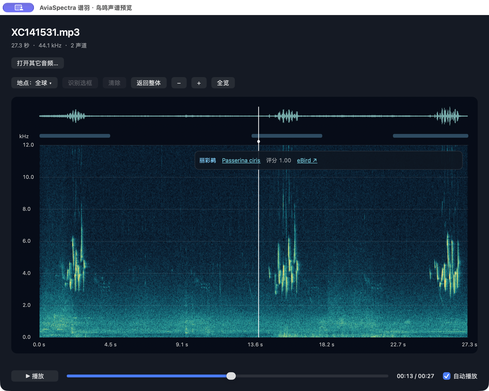
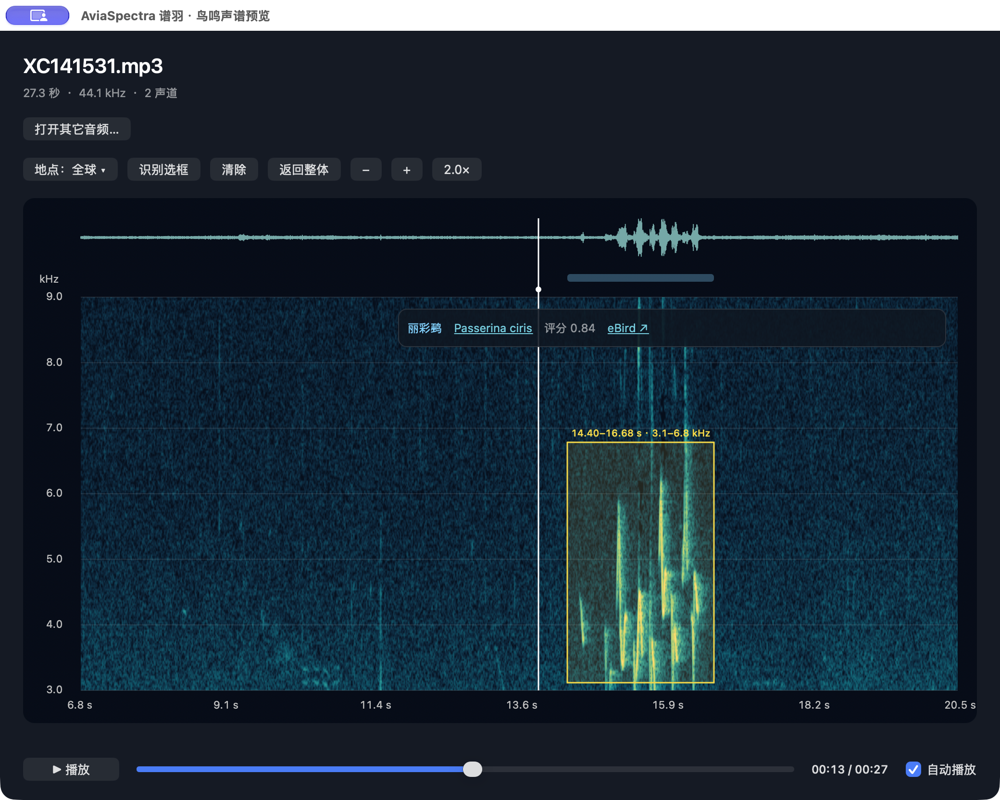
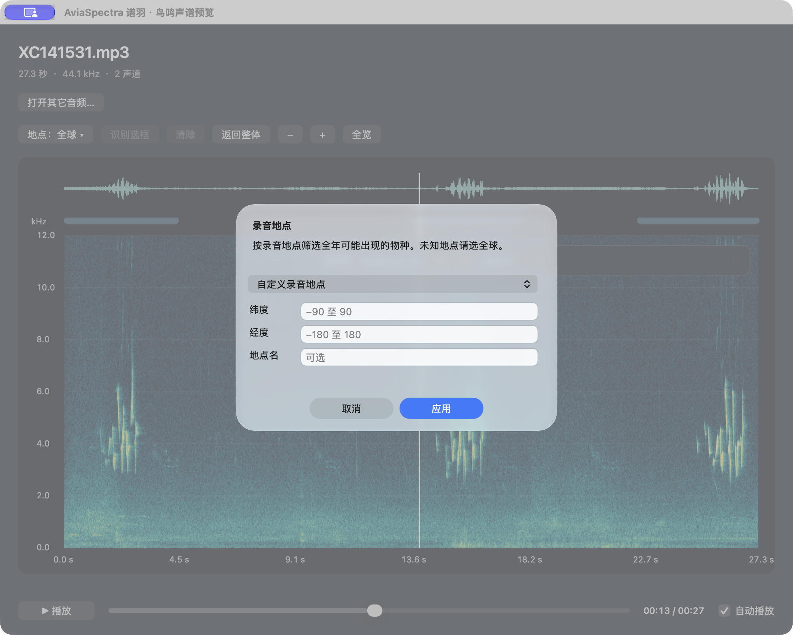

<p align="center"></p>

# AviaSpectra · 谱羽

**Thousands of bird recordings. Fewer steps to understand each one. Press Space to see, listen, and explore species candidates.**

[中文](README.md) · [Illustrated features](docs/FEATURES.en.md) · [Installation](docs/INSTALL.en.md) · [AI-assisted setup](docs/AI_INSTALL.en.md) · [All documentation](docs/INDEX.en.md)

## Why this exists

A folder may contain hundreds, thousands, or tens of thousands of bird recordings, often named with nothing more than an ID. Understanding one file can mean opening a player, switching to spectrogram software, running a recognizer, then searching for species information or reference recordings. **A few extra steps per file become a lot of switching and waiting across a large collection.**

AviaSpectra brings those steps into Finder Quick Look. Select a file and press Space: the spectrogram and playback appear first, followed by on-device BirdNET candidates. Zoom in, draw a selection to re-analyse a sound, and open XC or eBird links to check the result.

| Task | A common workflow across separate tools | With AviaSpectra |
|---|---|---|
| Listen and inspect structure | Open a player, then import into a spectrogram tool | Press Space for playback and a spectrogram together |
| Explore possible species | Run another recognizer and compare its output | Local candidates appear beside the spectrogram |
| Inspect one passage | Locate times, select a passage, or export a clip | Zoom, draw a box, and re-analyse the selection |
| Check a candidate | Copy the name and search the web | Click the scientific name or eBird link |

**Sub-second candidate feedback has been observed in short-recording demonstrations on the development Mac.** The interface displayed analysis times of approximately **0.1–0.6 seconds** in a small number of demonstrations. These are UI readings, not a formal benchmark or a standardized measurement from pressing Space to receiving all results. Initial model loading, cache state, recording length, and hardware affect waiting time. This helps you inspect individual files quickly; **it does not batch-identify an entire folder with one keystroke or replace manual verification**.

**Version 1.0.0: a source-first release.** Apple Silicon; local compilation; no Apple Developer Program membership required. Deployment target macOS 14+, actually tested on macOS 27.0.1. Other target systems and fresh-machine installation remain to be validated; see [validation](docs/VALIDATION.en.md). GitHub documentation is bilingual; **the app interface is currently Chinese**.

## See the actual app

These are real screenshots of AviaSpectra 1.0.0 running on the development Mac with test recording XC141531. They show the standalone app; Finder's Space-key preview shares the core controller but has different window chrome and no “Open another audio” button.

### See the sound and its species candidates together



The waveform sits above the spectrogram. The floating card shows **Painted Bunting · Passerina ciris** as a candidate, with scientific-name and eBird links for verification. The displayed 1.00 is a rounded model score, not 100% certainty.

### Zoom for detail, then draw a box to re-analyse



Both axes are zoomed **2×**. The yellow box covers **14.40–16.68 seconds and approximately 3.1–6.8 kHz**. After **识别选框** (Recognize selection), the card shows the selected passage's candidate with a score of 0.84. **返回整体** (Return to whole) restores the entire view and full-recording candidates.

### Choose where the recording was made



Open **地点：全球** (Location: Global) to choose a preset city or enter recording coordinates. Leave it Global when unknown. This is the recording location, not the computer's location. The screenshot shows the form without entering or applying a location.

[Step-by-step guide and screenshot provenance →](docs/FEATURES.en.md)

## Features

- **Space-key preview:** MP3/WAV playback, waveform and spectrogram in Finder.
- **On-device recognition:** BirdNET V2.4 is bundled during the local build; inference does not upload audio.
- **Equal-factor zoom:** time and frequency axes zoom together around the pointer.
- **Box re-analysis:** draw a time-frequency rectangle, then explicitly analyse it; zoom is independent of selection.
- **Return to the whole recording:** restore the complete view and full-recording candidates.
- **Recording-location filter:** coordinates with a year-round prior; use Global when the location is unknown.
- **Verification links:** a movable card shows Chinese/scientific names and scores, with XC/eBird links.
- **Multiple candidates:** coloured time spans correspond to candidates; a menu exposes more candidates.

## Quick start

1. Select **Code → Download ZIP**, extract to a normal folder on your Mac's internal storage.
2. Open the folder with Codex or another AI tool that can read local files and run terminal commands.
3. Give it this request:

> Read README.en.md, AGENTS.md, and docs/AI_INSTALL.en.md, and help me install AviaSpectra on this Mac. Check the environment first, then use the project scripts to download and verify dependencies, build, install, and register the Quick Look extension. Do not modify original audio or disable macOS security. Verify MP3/WAV preview, autoplay, box recognition, and return-to-whole behaviour, and explain how to disable or uninstall it.

Or install Apple Command Line Tools, then run in the repository root:

```sh
bash scripts/setup.sh
```

The script downloads approximately 81 MB of models/runtime dependencies, builds `build/AviaSpectra.app`, installs to `~/Applications/AviaSpectra.app`, and requests extension enablement. Initial downloading/building takes time. Open AviaSpectra once, then follow the [installation guide](docs/INSTALL.en.md) if the extension is not enabled.

Building uses the Python 3.9+ standard library. The finished app needs no Homebrew, Python environment, BirdNET Python package, or persistent background service. Species web links require connectivity; local inference does not.

## Controls

| Action | Result |
|---|---|
| Space in Finder | Open Quick Look |
| Scroll / two-finger vertical scroll / pinch | Zoom both axes equally |
| Horizontal scroll / Shift-scroll | Pan in time |
| Option-scroll | Pan the time/frequency view |
| Double-click / overview button | Reset only the view |
| Drag a rectangle → 识别选框 (Recognize selection) | Re-analyse selected time and frequency band |
| 返回整体 (Return to whole) | Clear selection, reset view, restore full-recording candidates |
| 地点：全球 (Location: Global) | Set the recording location, not the computer's location |
| Scientific name / eBird | Open a species page in the browser |

## Limits

- Only the **first 120 seconds** are previewed, played, and analysed.
- The spectrogram displays channel 1 up to 12 kHz. Recognition uses up to eight channels, so the two may represent different sounds in multichannel audio.
- Scores are not accuracy. Three-second window spans are not precise event boundaries or frequency-localization boxes. Verify candidates by listening.
- Geographic filtering can exclude vagrants; very short or narrow selections can remove useful information. Compare with Global or the whole recording.
- This is locally compiled source, not a notarized, download-and-run installer. Intel and untested macOS versions are not promised compatible.

## Disable, re-enable, or uninstall

Run the appropriate command in the project root:

```sh
python3 scripts/manage.py disable
python3 scripts/manage.py enable
python3 scripts/manage.py uninstall
```

Uninstall moves this app to Trash and retains original audio, preferences, and inference caches.

## Development and licensing

Build only: `bash scripts/setup.sh --build-only`. Tests: `python3 tests/smoke.py`. See [development](docs/DEVELOPMENT.en.md) and [contributing](CONTRIBUTING.en.md).

Original code is [MIT](LICENSE). BirdNET models are **CC BY-NC-SA 4.0, noncommercial**; LiteRT is Apache 2.0. Code licensing does not override model terms. See [third-party notices](THIRD_PARTY_NOTICES.en.md). This project is not affiliated with BirdNET, XC, or eBird.

No real recordings are included; test audio is synthesized. Issues are welcome in Chinese or English. Include hardware, macOS version, installation steps, and errors. See our [bilingual publishing policy](docs/BILINGUAL.en.md).
