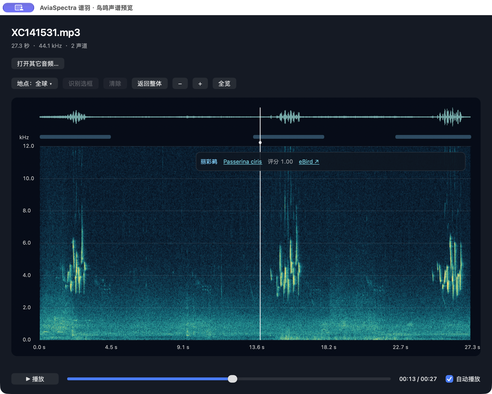
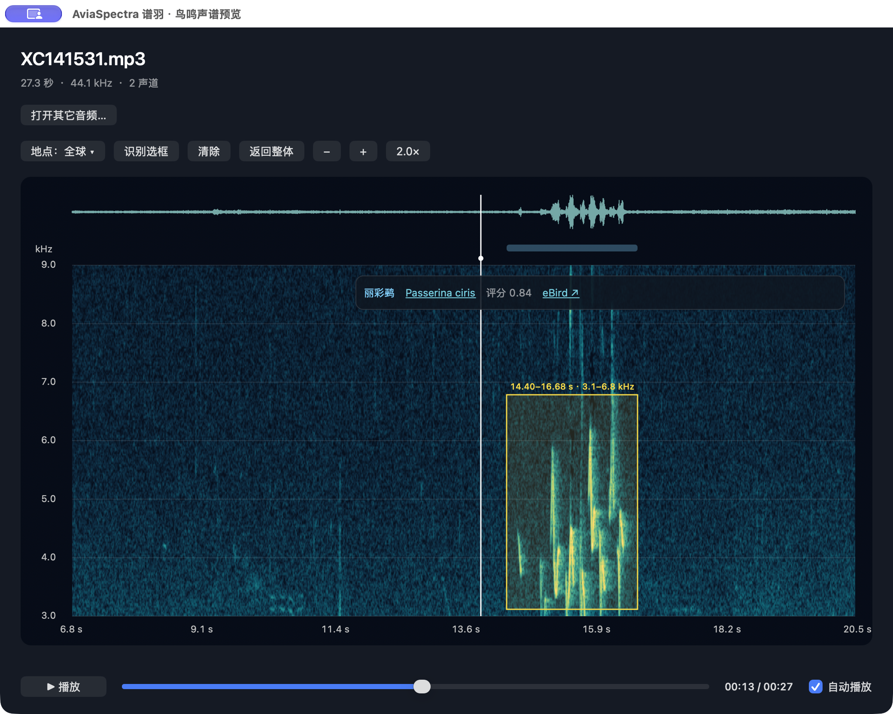
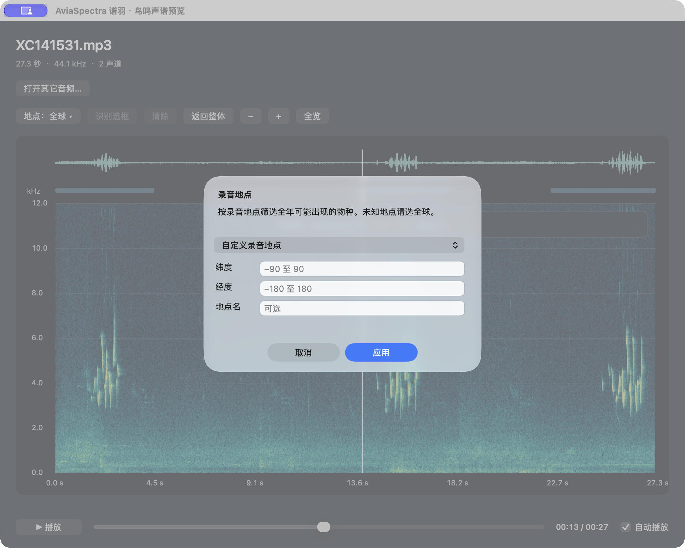

<p align="center"></p>

# AviaSpectra · 谱羽

**海量鸟鸣文件，逐个了解不该这么费劲。按一下空格，看声谱、听声音、查看物种候选。**

[English](README.en.md) · [图文功能介绍](docs/FEATURES.md) · [安装指南](docs/INSTALL.md) · [交给 AI 安装](docs/AI_INSTALL.md) · [全部文档](docs/INDEX.md)

## 为什么做这个工具

面对成百上千、甚至数万段鸟鸣录音，文件名往往只是一串编号。想知道其中是什么声音，常常要打开播放器试听，再切换到声谱软件看细节，运行识别工具，最后打开物种资料或参考录音核实。**每个文件多几步，放到海量文件里，就变成反复切换软件和等待的时间。**

AviaSpectra 把这些信息集中在 Finder 的快速预览里：选中文件，按一下空格，先看声谱、先听声音，本机 BirdNET 候选随后出现。遇到感兴趣的声音，可以直接放大、画框重新识别，再跳转 XC 或 eBird 核实。

| 了解一段陌生录音 | 常见的分散操作 | AviaSpectra |
|---|---|---|
| 听声音、看结构 | 打开播放器，再导入声谱软件 | 按空格，声谱与播放在同一预览中 |
| 判断可能的物种 | 再运行识别工具、对照结果 | 本机识别，候选直接显示在声谱旁 |
| 聚焦一个片段 | 查找时间位置、选区或另行导出 | 直接缩放、画框，再点“识别选框” |
| 查资料核实 | 复制名称，再搜索网站 | 点击拉丁名或 eBird 链接 |

**零点几秒的候选反馈，已在开发机的短音频演示中出现。** 界面曾显示约 **0.1–0.6 秒**的分析耗时。这是少量演示中的界面读数，不是正式性能基准，也不是从按空格到全部结果出现的统一计时；首次模型加载、缓存状态、音频长度和设备都会影响实际等待时间。它帮助你快速了解单个文件，**不是一次按键批量识别整个文件夹，也不替代人工核实**。

**版本：1.0.0，首个源码分享版。** 首版支持 Apple Silicon，本机编译安装，无需 Apple Developer Program 账号。构建目标 macOS 14+，实际验证环境为 macOS 27.0.1；其他目标系统与新电脑安装仍待验证，见[验证记录](docs/VALIDATION.md)。GitHub 文档提供中英文版本；**应用界面目前仍为中文**。

## 看实际界面

以下是 AviaSpectra 1.0.0 在开发机上运行的真实截图，使用 XC141531 测试录音。展示的是独立应用窗口；Finder 空格预览使用相同核心控制器，窗口外框与“打开其它音频”按钮有所不同。

### 一眼看到声音结构和物种候选



上方是波形，下方是声谱，浮动卡片显示候选 **丽彩鹀 · Passerina ciris**。在同一界面听声音、看结构，并通过拉丁名和 eBird 链接核实。截图中的 1.00 是四舍五入后的模型评分，不代表百分之百正确。

### 放大细节，画框后再识别



图中已放大 **2 倍**，黄色框选中 **14.40–16.68 秒、约 3.1–6.8 kHz**。点击“识别选框”后，卡片更新为该选区的候选，评分显示 0.84。点击“返回整体”，恢复整段声谱和候选。

### 为录音选择地区



点击“地点：全球”，可选预设城市或输入录音地点的经纬度。未知地点保持全球；使用的是录音地点，不是电脑所在地。截图展示输入表单，未填写或应用地点。

[查看逐步功能说明与截图来源 →](docs/FEATURES.md)

## 能做什么

- **空格预览**：Finder 选中 MP3 或 WAV，按空格打开声谱与播放器。
- **本机识别**：BirdNET V2.4 模型随本机构建打包；推断时音频不上传服务器。
- **等比例缩放**：时间轴与频率轴同步缩放，以指针位置为中心查看细节。
- **画框重识别**：拖出时间×频率矩形，点击“识别选框”。选框与缩放范围独立。
- **返回整体**：一次恢复完整声谱与整段识别候选。
- **地点筛选**：使用录音地点的经纬度筛选全年候选；未知地点选全球。
- **快速核实**：浮动卡片显示中文名、拉丁名及评分，链接到 XC 和 eBird 物种页面。
- **多个候选**：不同颜色对应候选时间条，更多候选可通过菜单切换。

## 直接体验真实鸟鸣

项目已自带 **3 段真实鸟鸣 MP3 + 1 份 WAV 副本，合计约 3.6 MB**。安装后打开 [samples 文件夹](samples/README.md)，选中音频按空格即可体验，无需另外寻找或下载样本。包含小嘴乌鸦、赭红尾鸲和原鸽，作者署名及 CC BY-SA 4.0 许可随音频附上。

## 最快开始

1. 点击本项目绿色 **Code → Download ZIP**，解压到 Mac 内置磁盘上的普通文件夹。
2. 用 Codex 或其他能读取本地文件、执行终端命令的 AI 工具打开该文件夹。
3. 复制下面这段话：

> 请阅读这个项目的 README.md、AGENTS.md 和 docs/AI_INSTALL.md，帮助我在这台 Mac 上安装 AviaSpectra。先检查环境，再使用项目脚本下载并校验依赖、编译、安装和注册 Quick Look 扩展。不要修改原始音频，也不要关闭 macOS 安全机制。最后验证 MP3/WAV 的预览、自动播放、画框识别和返回整体，并告诉我怎样停用或卸载。

**也可以手动安装**：先安装 Apple Command Line Tools，然后在项目根目录执行：

```sh
bash scripts/setup.sh
```

脚本将联网下载约 81 MB 的模型与运行库，编译到 `build/AviaSpectra.app`，安装到 `~/Applications/AviaSpectra.app` 并请求启用扩展。首次编译和下载需要时间，取决于网络与电脑性能。完成后打开 AviaSpectra 一次；如系统尚未启用扩展，按[安装指南](docs/INSTALL.md)操作。

不需要 Homebrew、Python 虚拟环境、BirdNET Python 包或运行中的后台服务。构建脚本使用 Python 3.9+ 标准库；Apple Command Line Tools 通常提供所需 Python。仅打开网站链接时才需要浏览器联网。

## 操作速查

| 操作 | 作用 |
|---|---|
| Finder 中按空格 | 打开预览 |
| 滚轮 / 两指上下滚动 / 捏合 | 时间与频率同步缩放 |
| 横向滚动 / Shift+滚动 | 平移时间轴 |
| Option+滚动 | 平移频率与时间视野 |
| 双击图面 / 全览（倍率）按钮 | 仅恢复完整视图 |
| 左键拖出矩形 → 识别选框 | 对框选时间和频带重新推断 |
| 返回整体 | 清除选框，恢复完整视图及整段候选 |
| 地点：全球 | 选择录音地点，而非电脑所在地点 |
| 拉丁名 / eBird | 在浏览器打开物种页面 |

## 使用边界

- 首版最多预览、试听和识别音频的**前 120 秒**。
- 声谱显示第 1 声道、最高 12 kHz；识别使用最多 8 个声道。多声道的图像与识别所含声音可能不同。
- 模型评分不是准确率；候选须复听核实。3 秒窗口时间条不是精确鸟鸣边界，也不是频率定位框。
- 地点筛选可能排除迷鸟。选框过短或频带过窄也可能削弱识别；可返回整体或全球比较。
- 当前仅提供源码本机构建，不提供“已公证、下载即运行”的安装包，不承诺 Intel 或其他系统版本兼容。

## 停用 / 恢复 / 卸载

在项目根目录执行：

```sh
python3 scripts/manage.py disable
python3 scripts/manage.py enable
python3 scripts/manage.py uninstall
```

分别用于停用、恢复、卸载；按需要选择一条执行。卸载将本版应用移到废纸篓，保留原始音频、偏好与推断缓存。

## 开发与许可

仅构建，不安装：`bash scripts/setup.sh --build-only`。测试：`python3 tests/smoke.py`。架构与贡献方法见 [DEVELOPMENT.md](docs/DEVELOPMENT.md)。

AviaSpectra 原创代码采用 [MIT](LICENSE)；BirdNET 模型采用 **CC BY-NC-SA 4.0，仅限非商业用途**；LiteRT 采用 Apache 2.0。源码许可不改变模型使用条件。来源和署名见 [THIRD_PARTY_NOTICES.md](THIRD_PARTY_NOTICES.md)。本项目与 BirdNET、XC、eBird 无官方隶属关系。

自带三段获许可的真实鸟鸣及一份 WAV 格式副本，见 [samples](samples/README.md)；合成测试音仍由脚本生成。欢迎通过 Issues 提交问题与建议，请注明芯片、系统版本、安装步骤及错误信息。
