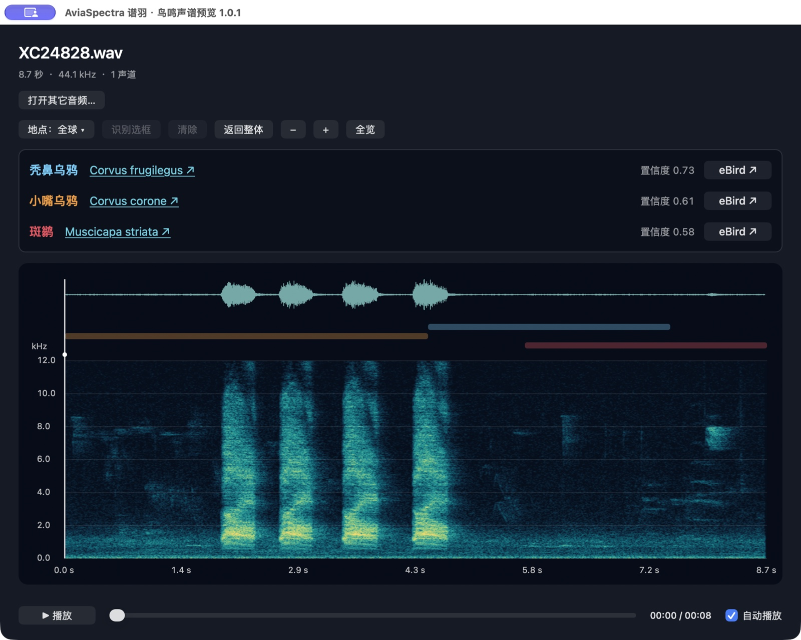

# Illustrated feature guide

[中文](FEATURES.md)

For large folders of numbered recordings, press Space to hear audio, see its spectrogram and inspect species candidates together. Version 1.0.1 uses larger fixed result rows above the plot and dedicated eBird buttons; row colours correspond to timeline bars.

1. Select an MP3/WAV in Finder and press Space. The spectrogram appears before recognition finishes.
2. Use the wheel or trackpad to zoom time and frequency equally.
3. Draw a rectangle and press 识别选框 (Recognize selection). Zoom alone does not re-identify audio.
4. 返回整体 (Return to whole) restores the entire plot and full-recording candidates.
5. Scientific names open XC; eBird buttons open species information. The Location menu uses the recording location.

The screenshot uses included XC24828, labelled Carrion Crow by its source. Other displayed candidates do not establish the presence of those species. Confidence is not calibrated accuracy. Recordist credits, sources and CC BY-SA 4.0 terms are in [samples](../samples/README.en.md). This is a real interface screenshot, not an AI redraw. Previous screenshots remain as historical assets.

The first 120 seconds are supported; the plot shows channel 1 up to 12 kHz. See [USAGE](USAGE.en.md) and [VALIDATION](VALIDATION.en.md).

The Finder Quick Look host may refuse browser launches. If prompted, choose Copy link and paste it into your browser. Direct eBird opening has been verified in the standalone app.
