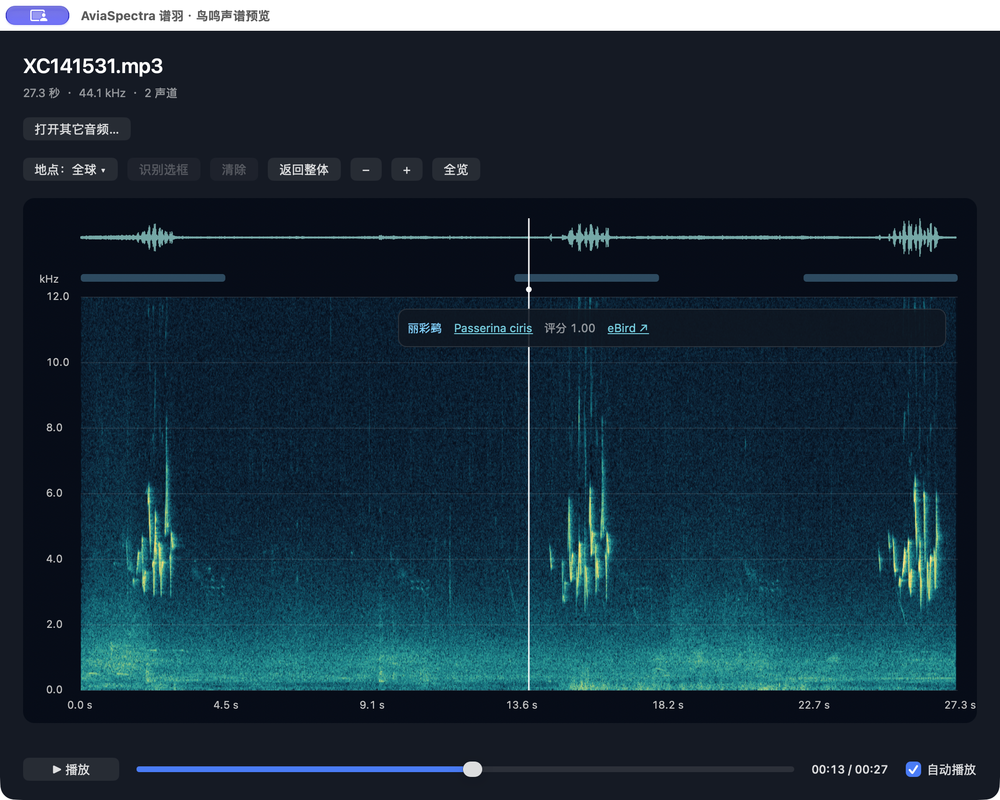
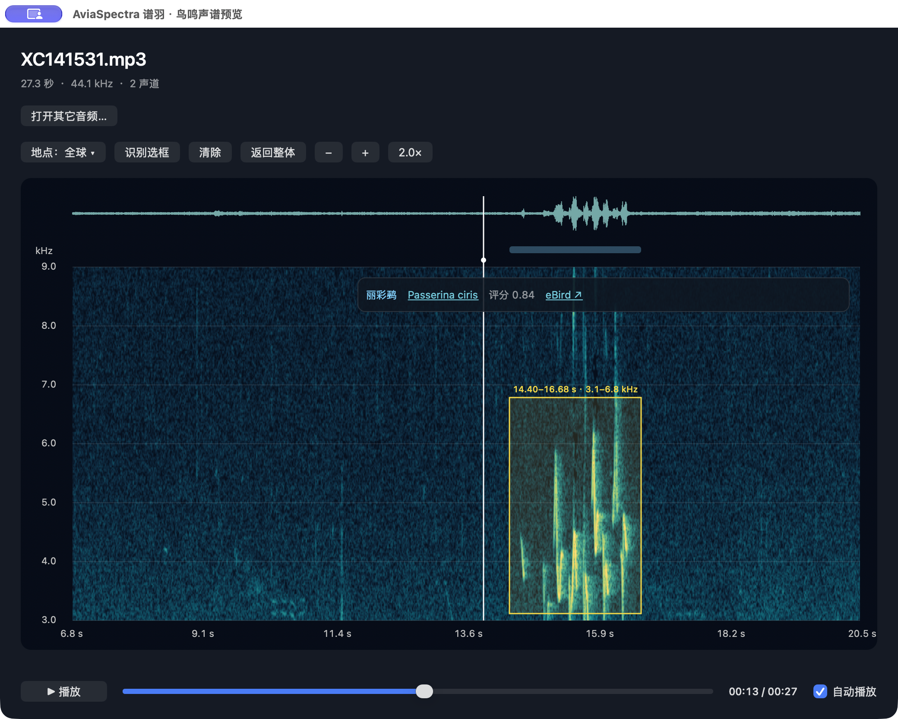
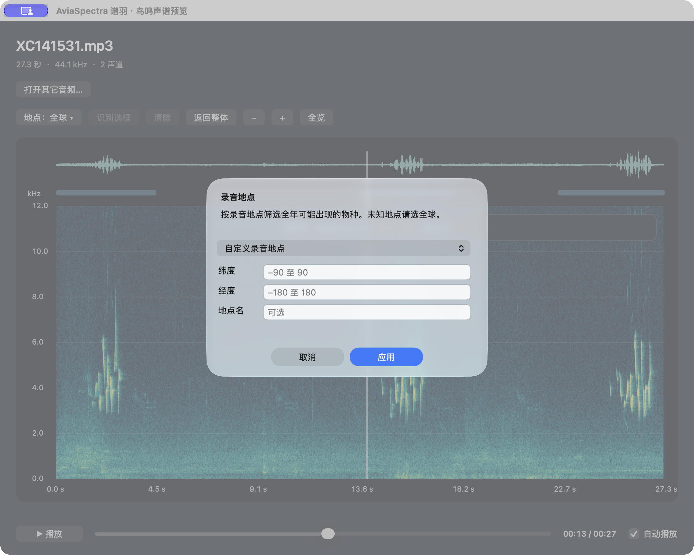

# AviaSpectra: actual interface and features

[中文](FEATURES.md) · [Home](../README.en.md) · [Installation](INSTALL.en.md) · [Full controls](USAGE.en.md)

## Large recording collections, fewer repeated steps

A folder of thousands of recording IDs often means opening a player, importing audio into a spectrogram tool, running recognition and searching references for each file. AviaSpectra brings those steps into one preview: select an MP3 or WAV in Finder and press Space to listen and inspect; local species candidates follow.

Short-file development demonstrations displayed analysis times of about 0.1–0.6 s. These are UI observations, not a universal end-to-end guarantee. Initial loading, cache, hardware and duration affect waiting.

## 1. Full-recording view, playback and species candidates

- **Waveform and spectrogram:** the waveform helps locate audible passages; the spectrogram shows time in seconds and frequency in kHz.
- **Listen while inspecting:** use the bottom playback button and progress slider. **自动播放** toggles automatic playback.
- **Floating candidate card:** this example shows Painted Bunting (Passerina ciris). Its scientific name opens XC; **eBird** opens species information.
- **Multiple candidates:** other recordings can show several candidates via the card and candidate menu. This screenshot contains one candidate, not a multi-species demonstration.

Blue spans represent recognition windows, not exact bird-call boundaries. The rounded score of 1.00 is a model output, not certainty; verify by listening.

## 2. Zoom to inspect, draw a box to re-analyse

1. Scroll, two-finger scroll, pinch, or use **＋／−** to zoom both axes equally. This view is at **2.0×**.
2. Drag a yellow rectangle on the spectrogram. The example selects **14.40–16.68 seconds and approximately 3.1–6.8 kHz**.
3. Click **识别选框** (Recognize selection). The app crops and band-pass filters that passage before inference. This example's candidate score becomes **0.84**.
4. Click **返回整体** (Return to whole) to clear the box and restore the full spectrogram and full-recording candidates.

**Zoom improves visibility; the yellow box defines re-analysis.** **清除** clears the box. **全览** or the zoom-factor button resets only the view. **返回整体** also restores full-recording results. Narrow bands or very short passages can weaken recognition.

## 3. Filter candidates by recording location

Click **地点：全球 ▾** (Location: Global), choose a preset city or **自定义录音地点** (Custom recording location), enter latitude, longitude and an optional name, then click **应用** (Apply). Keep **全球（不限制）** (Global, unrestricted) when unknown. This screenshot shows the custom form; no location was entered or applied.

Filtering uses a year-round geographic prior. It does not read the computer's GPS and has no month selector. It narrows candidates but may exclude vagrants; compare with Global.

## Screenshot provenance and limits

- Captured on 2026-11-13 from a locally built AviaSpectra 1.0.0 on Apple Silicon after real interactions. Full application-window captures; buttons, spectrograms and results were not redrawn.
- These show the **standalone app**. Finder Quick Look shares the core controller but has different window chrome and no “Open another audio” button. This is not a Finder installation acceptance record for the new release identifiers.
- The UI remains Chinese. Both language editions use the same real screenshots; English text explains the Chinese controls.
- Example recording: [XC141531 by Mike Nelson](https://xeno-canto.org/141531). The repository shows UI screenshots and does not distribute the original audio. Recording copyright and reuse conditions remain those of the original recording page.
- Only the first **120 seconds** are handled; the spectrogram displays channel 1 up to **12 kHz**. Candidates require verification. See [validation](VALIDATION.en.md) for system and installation limits.
