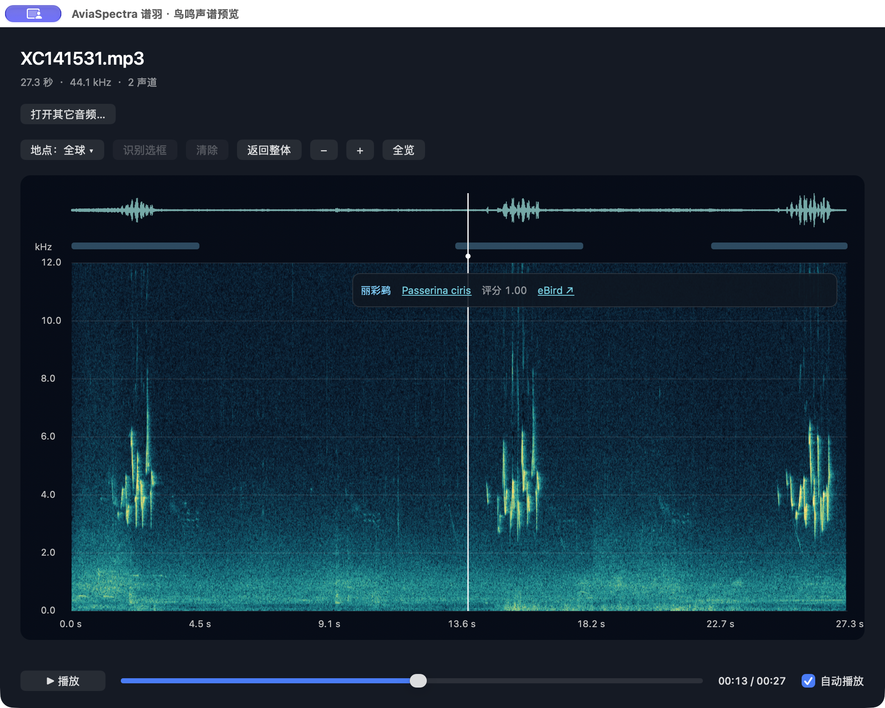
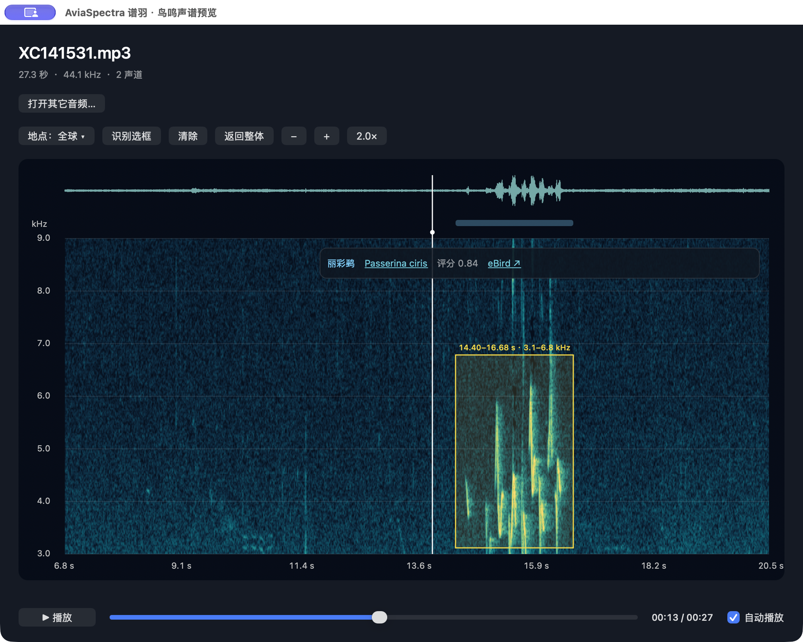
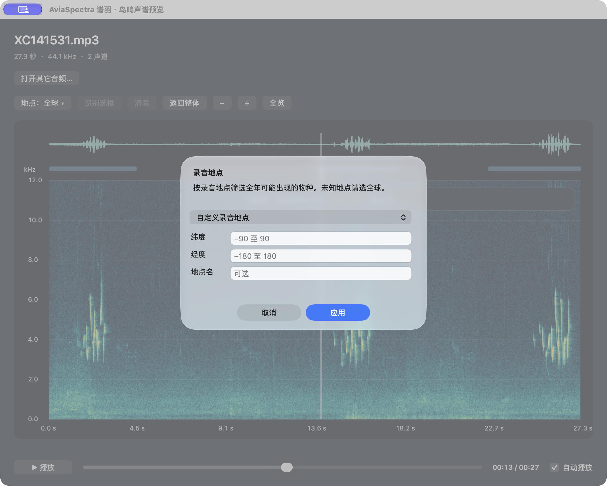

# AviaSpectra 实际界面与功能

[English](FEATURES.en.md) · [返回首页](../README.md) · [安装指南](INSTALL.md) · [完整操作说明](USAGE.md)

## 海量文件，少一些反复操作

面对成千上万条编号录音，过去往往要逐个打开播放器、导入声谱工具、运行识别，再搜索参考资料。AviaSpectra 把这些信息放在同一个预览界面：在 Finder 选中 MP3 或 WAV，按空格，先听声音、看声谱，本机物种候选随后出现。

开发机短音频演示曾显示约 0.1–0.6 秒分析耗时。这是界面观察，不是统一的端到端速度保证；首次加载、缓存、设备和音频长度都会影响等待。

## 1. 整段声谱、播放与物种候选

- **波形与声谱**：上方波形快速定位明显发声段，下方声谱显示时间与频率结构。横轴为秒，纵轴为 kHz。
- **听与看同步**：底部播放按钮和进度条控制试听；“自动播放”可按需要开关。
- **浮动候选卡片**：本例显示丽彩鹀（Passerina ciris）。点击拉丁名访问 XC，点击 eBird 查物种资料。
- **多个候选**：其他录音若有多个候选，可通过卡片和候选菜单查看；本张截图只展示一个候选，不把它描述成多物种演示。

蓝色时间条对应模型识别窗口，不是精确鸟鸣边界。评分 1.00 是四舍五入的模型输出，仍需复听核实。

## 2. 放大看清，再画框重识别

1. 使用滚轮、两指滚动、捏合或 **＋／−** 同倍率缩放两轴。本图为 **2.0×**。
2. 在声谱图上拖出黄色矩形，选择时间和频率范围。本例为 **14.40–16.68 秒、约 3.1–6.8 kHz**。
3. 点击 **识别选框**。程序对所选片段裁剪、带通滤波后重新推断；本例候选评分更新为 **0.84**。
4. 点击 **返回整体**，清除选框，恢复完整声谱和整段候选。

**放大是为了看清；黄色选框才决定重识别的范围。** “清除”移除选框；“全览／倍率”按钮只复位视图；“返回整体”同时恢复整段识别结果。频带太窄或片段太短可能降低识别表现。

## 3. 根据录音地区筛选候选

点击 **地点：全球 ▾**，选择预设城市或 **自定义录音地点**，输入纬度、经度及可选地点名，再点 **应用**。地点未知则保持 **全球（不限制）**。本图仅展示自定义输入表单，未填写或应用地区。

筛选使用全年地区先验，不读取电脑 GPS，也不提供月份选择。它可以缩小候选范围，但可能排除迷鸟；建议与全球结果比较。

## 截图来源与使用边界

- 2026-11-13，Apple Silicon Mac 上本地构建的 AviaSpectra 1.0.0，真实操作后截取完整应用窗口；未重画按钮、声谱或识别结果。
- 展示的是**独立应用**。Finder 快速预览共用核心控制器，但窗口外框及“打开其它音频”按钮不同；本页不是新发布标识的 Finder 安装验收记录。
- 界面仍为中文；中英文说明引用同一组真实截图，英文文档解释对应中文按钮。
- 示例录音：[XC141531，Mike Nelson](https://xeno-canto.org/141531)。本仓库只展示界面截图，不分发原始录音；录音版权和使用条件以原录音页为准。
- 最多处理音频前 **120 秒**；声谱显示第 1 声道、最高 **12 kHz**。候选需核实。安装与系统限制见[验证记录](VALIDATION.md)。
