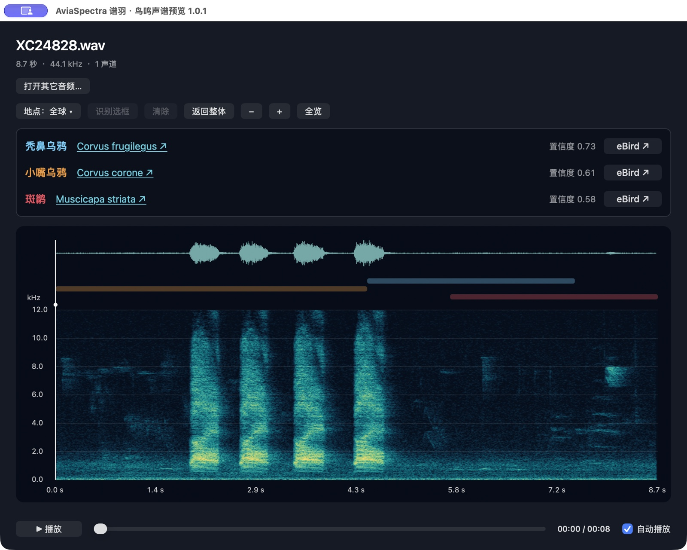

# 功能图文介绍

[English](FEATURES.en.md)

面对海量编号录音，按空格即可在一个预览中听声音、看声谱、查看物种候选。1.0.1 将结果移至声谱图上方的固定信息栏，增大文字并给 eBird 独立按钮；多候选按行显示，与时间条颜色对应。

1. Finder 选中 MP3/WAV，按空格；声谱先出现，识别随后更新。
2. 滚轮或两指手势让时间轴、频率轴等比例缩放。
3. 在图上拖出矩形，再点“识别选框”。放大本身不会触发重新识别。
4. 点“返回整体”恢复完整图像和整段候选。
5. 点击拉丁名核实 XC 录音，或用 eBird 查看物种资料；地点菜单可选择录音地点。

截图使用随项目提供的 XC24828。物种来源标注为小嘴乌鸦；界面中的其他候选并不证明这些物种都存在。置信度不是校准准确率。录音者、来源及 CC BY-SA 4.0 许可见 [samples](../samples/README.md)。截图是真实程序界面，未通过 AI 重绘。旧版本截图保留为历史素材。

最多处理前 120 秒，声谱显示第 1 声道、最高 12 kHz。完整操作见 [USAGE](USAGE.md)，验证范围见 [VALIDATION](VALIDATION.md)。

Finder 快速预览宿主可能拒绝浏览器跳转；此时点击“复制链接”，再粘贴到浏览器。独立应用已验证可直接打开 eBird。
